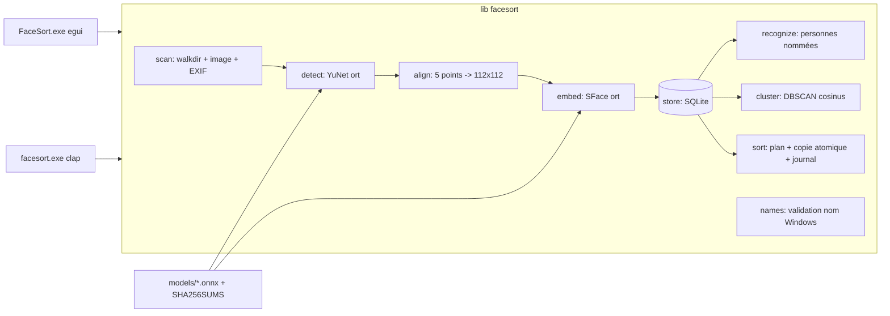

# FaceSort - Architecture technique

> Version 1 · 2026-11-11

## 1. Résumé

| Couche | Choix | Pourquoi | Alternative écartée |
|---|---|---|---|
| Interface | `eframe`/`egui` 0.37 (GUI) + `clap` (CLI) | Conventions de tes projets (FontLicenseClassifier, NetPulse) ; GUI immédiate suffisante pour une grille de vignettes | Tauri (HTML/JS en plus, sans bénéfice ici) |
| Inférence | `ort` 2.0.0-rc.15 (ONNX Runtime), CPU | Seule voie Rust mature pour exécuter des modèles ONNX ; DirectML disponible plus tard par feature | `tract` (pur Rust, compatibilité opérateurs YuNet/SFace non vérifiée) ; OpenCV via `opencv` crate (dépendance C++ lourde à compiler sous Windows) |
| Détection | YuNet (OpenCV Zoo, MIT) | Licence permissive, petit modèle, fournit les 5 points de repère nécessaires à l'alignement | RetinaFace InsightFace : « non-commercial research purposes only » (D1, F10) |
| Reconnaissance | SFace (OpenCV Zoo, Apache 2.0) | Licence permissive, conçu pour l'alignement 5 points | ArcFace InsightFace : même restriction de licence |
| Logique | Bibliothèque `facesort` (regroupement, reconnaissance, tri, validation des noms) | Testable sans GUI ni modèle (empreintes synthétiques) | Logique dans la GUI |
| Stockage | SQLite via `rusqlite` 0.42 `bundled`, `%LOCALAPPDATA%\FaceSort\facesort.db` | Base embarquée, une source de vérité partagée GUI/CLI, déjà utilisée dans tes projets | Fichiers JSON (pas de requêtes, écritures non atomiques) |
| Serveur / services | Sans objet : tout est local | Aucune donnée partagée, aucune clé, aucun traitement en absence de l'utilisateur | - |
| Tests | `cargo test` : unitaires + intégration sur fixtures | Une commande | - |
| Distribution | Dossier portable : `FaceSort.exe`, `facesort.exe`, DLL ONNX Runtime, `models/` | Usage personnel ; pas d'installeur nécessaire | Installeur MSI (V2 si diffusion) |

## 2. Contexte existant

Nouveau projet, aucun code existant. Conventions reprises des projets voisins : edition 2024, crate unique avec `[lib]` et deux `[[bin]]` (modèle `FontLicenseClassifier/Cargo.toml`), `rfd` pour les sélecteurs de dossier, `rayon` pour le parallélisme, `walkdir` pour le parcours.

## 3. Composants



- **scan** : parcours récursif, filtre `.jpg/.jpeg/.png`, détection des fichiers inchangés (chemin, taille, mtime), décodage, orientation EXIF, réduction à 1 600 px.
- **detect / embed** : enveloppes `ort` derrière les traits `FaceDetector` et `FaceEmbedder` (permet F10 RetinaFace et des faux en test).
- **align** : transformation de similarité estimée sur 5 points vers le gabarit 112x112, interpolation bilinéaire, code maison (environ 100 lignes).
- **recognize** : similarité cosinus maximale contre les visages confirmés de chaque personne, seuil et marge d'ambiguïté (AC-F4-3).
- **cluster** : DBSCAN sur distance cosinus, `min_samples = 2`, ordre de parcours stable (AC-F2-3), parallélisé avec `rayon`.
- **sort** : calcule un plan (liste de copies) puis l'exécute ; le `--dry-run` s'arrête au plan.
- **names** : règles de nom de dossier Windows (AC-F3-3).

## 4. Local ou serveur

| Fonction | Où elle s'exécute | Service externe | Clé secrète | Repli si indisponible |
|---|---|---|---|---|
| Scan, détection, empreintes | Local (CPU) | Aucun | Non | - |
| Regroupement, reconnaissance | Local | Aucun | Non | - |
| Tri par copie | Local | Aucun | Non | - |
| Obtention des modèles ONNX | Une fois, au build (script) | GitHub opencv_zoo | Non | Fichiers copiés à la main ; contrôle SHA-256 au démarrage |
| Binaires ONNX Runtime | Au build (`ort` feature `download-binaries`, par défaut) | Serveurs de pyke **[À vérifier]** | Non | Feature `load-dynamic` + DLL officielle Microsoft placée à côté de l'exécutable |

Aucune API payante, aucun réseau à l'exécution.

## 5. Modèle de données

Base SQLite, `PRAGMA user_version = 1`, mode WAL (GUI et CLI peuvent lire en même temps).

- `photos(id, path TEXT UNIQUE, size, mtime, sha256, width, height, scanned_at, error TEXT NULL)`
- `faces(id, photo_id FK, x, y, w, h, score REAL, landmarks BLOB, embedding BLOB (f32 x D), thumb BLOB (JPEG 96 px), person_id FK NULL, assignment TEXT CHECK IN ('none','manual','auto'), cluster_id INTEGER NULL)`
- `persons(id, name TEXT UNIQUE COLLATE NOCASE, created_at)`
- `face_exclusions(face_id, person_id, PRIMARY KEY(face_id, person_id))` (AC-F3-4)
- `meta(key, value)` : `detector_model`, `embedder_model` (nom + SHA-256). Si le modèle d'empreinte change, les empreintes ne sont plus comparables : l'application demande un rescan complet.

Volume prévu : 10 000 photos, 20 000 visages, environ 130 Mo (vignettes comprises) **[H3]**. Conservation : jusqu'à suppression du fichier par l'utilisateur. `sha256` sert à AC-F5-2 et AC-F5-4.

## 6. Interfaces et intégrations

- **Modèles** : `models/face_detection_yunet_2023mar.onnx` (entrée fixe) ou `face_detection_yunet_2026may.onnx` (entrée dynamique), à trancher en T2 ; `models/face_recognition_sface_2021dec.onnx`. Taille d'entrée et dimension de l'empreinte SFace (112x112, 128 attendus) **[À vérifier]** en T3 en lisant les métadonnées du modèle avec `ort`. Format de sortie YuNet (cadres, 5 points, scores, éventuel post-traitement à faire en Rust) **[À vérifier]** en T2 contre l'implémentation de référence d'opencv_zoo.
- **CLI** : voir F6. Sortie lisible par défaut, `--json` ; progression sur stderr.
- **Journal de tri** : CSV UTF-8 `source,destination,personne,statut` (`copiee`, `deja_presente`, `renommee`, `erreur`).

## 7. Authentification et permissions

Sans objet : application locale mono-utilisateur. Accès fichiers limité aux dossiers choisis et à `%LOCALAPPDATA%\FaceSort`.

## 8. Sécurité, validation et erreurs

- **Entrées** : chemins canonisés ; destination refusée si elle est dans un dossier source (sinon les copies seraient rescannées) ; noms de personnes validés (F3) ; images décodées avec une limite de dimensions (`image::Limits`, par exemple 100 Mpx) pour éviter l'épuisement mémoire sur un fichier piégé.
- **SQL** : requêtes paramétrées uniquement.
- **Écriture atomique** : copie vers `.<nom>.facesort-tmp` puis `rename` ; transaction SQLite par lot de photos.
- **Erreurs** : `thiserror` dans la lib, `anyhow` dans les binaires ; message court à l'utilisateur, détail dans `%LOCALAPPDATA%\FaceSort\facesort.log` (chemins, pas d'empreintes).
- **Modèles** : SHA-256 vérifié au démarrage contre `models/SHA256SUMS` ; échec = message « modèle manquant ou modifié » et sortie code 1.
- **Secrets** : aucun ; pas de `.env`.
- **Données biométriques** : jamais exportées, jamais journalisées ; chemin de la base affiché pour suppression.

## 9. Dépendances

| Dépendance | Rôle | Licence | Coût | Alternative |
|---|---|---|---|---|
| `ort` =2.0.0-rc.15 (version exacte, pas de stable publiée) | Inférence ONNX | MIT OR Apache-2.0 (crates.io, 2026-11-11) | 0 | `tract` |
| ONNX Runtime (DLL) | Moteur d'inférence | MIT **[À vérifier]** | 0 | - |
| YuNet | Détection | MIT (opencv_zoo) | 0 | RetinaFace (non commercial) |
| SFace | Empreintes | Apache 2.0 (opencv_zoo) | 0 | ArcFace (non commercial) |
| `eframe`/`egui` 0.37, `rfd` 0.18, `rusqlite` 0.42, `rayon` 1.12, `walkdir` 2.5, `serde`, `serde_json` | GUI, dialogues, base, parallélisme, parcours | MIT/Apache **[À vérifier]** par `cargo deny` ou lecture | 0 | - |
| `image` 0.25 (jpeg, png) | Décodage ; orientation EXIF via l'API du décodeur **[À vérifier]**, sinon `kamadak-exif` | MIT/Apache | 0 | - |
| `clap`, `sha2`, `thiserror`, `anyhow`, `csv`, `tempfile` (dev) | CLI, hachage, erreurs, journal, tests | Versions **[À vérifier]** au `cargo add` | 0 | - |

## 10. Tests

- **Unitaires** (lib, sans modèle) : validation des noms, regroupement et reconnaissance sur empreintes synthétiques, plan de tri, collisions de noms, alignement (points connus).
- **Intégration** (avec modèles, `tests/`) : scan des fixtures, tri dans `tempfile::TempDir`, binaire CLI exécuté avec `std::process::Command`. Ignorés avec un message clair si `models/` est absent.
- **Évaluation qualité** (T11) : `cargo run --release --example eval -- fixtures-private/eval` sur le jeu annoté de l'utilisateur (non versionné : photos privées).
- **Manuel** : scénarios M1 à M4 (RISKS_AND_TESTS.md).
- **Commande unique** : `cargo test` ; puis `cargo clippy -- -D warnings`.

Fixtures versionnées : uniquement des images libres de droits avec visages (source et licence notées dans `fixtures/SOURCES.md`) **[À vérifier]** la disponibilité d'un jeu adapté ; à défaut, fixtures générées localement à partir de photos de l'utilisateur et non versionnées.

## 11. Build, déploiement et maintenance

`scripts/fetch-models.ps1` télécharge les modèles et vérifie `SHA256SUMS`. `cargo build --release` ; `ort` copie la DLL ONNX Runtime à côté des exécutables (feature `copy-dylibs`, par défaut, comportement exact sous Windows **[À vérifier]** en T1). `scripts/package.ps1` assemble le dossier portable. Mise à jour d'`ort` : lire le changelog, la version rc pouvant changer l'API.

## 12. Coûts récurrents

| Poste | Coût | Source |
|---|---|---|
| Logiciel, modèles, hébergement | 0 | Licences ci-dessus, aucun serveur |

## 13. Décisions d'architecture

- **ADR-1 - Modèles OpenCV Zoo plutôt qu'InsightFace** : l'utilisateur a cité RetinaFace, mais le model zoo InsightFace indique « ALL models are available for non-commercial research purposes only ». YuNet + SFace sont sous MIT et Apache 2.0. Conséquence : qualité potentiellement inférieure (H2), mesurée en T11 ; un trait `FaceDetector` garde la porte ouverte à RetinaFace (F10).
- **ADR-2 - `ort` en version rc épinglée** : pas de version stable 2.x publiée au 2026-11-11 ; `=2.0.0-rc.15` évite une rupture d'API silencieuse.
- **ADR-3 - Seuls les visages confirmés servent de référence** : empêche qu'une erreur « auto » attire d'autres erreurs (dérive).
- **ADR-4 - Plan puis exécution pour le tri** : le même code produit l'aperçu et la copie, ce qui garantit que l'aperçu dit vrai (AC-F5-1).

## 14. Arborescence proposée

```
FaceSort/
  Cargo.toml            # [lib] facesort, [[bin]] FaceSort (GUI), [[bin]] facesort (CLI)
  README.md
  models/SHA256SUMS     # les .onnx sont téléchargés, non versionnés
  scripts/fetch-models.ps1, package.ps1
  src/lib.rs
  src/{scan,detect,align,embed,store,recognize,cluster,sort,names}.rs
  src/bin/gui/{main,app,screens}.rs
  src/bin/cli.rs
  examples/eval.rs
  tests/{scan,sort,cli}.rs
  fixtures/{basic,people3,people3_new,exif}/ + SOURCES.md
```
